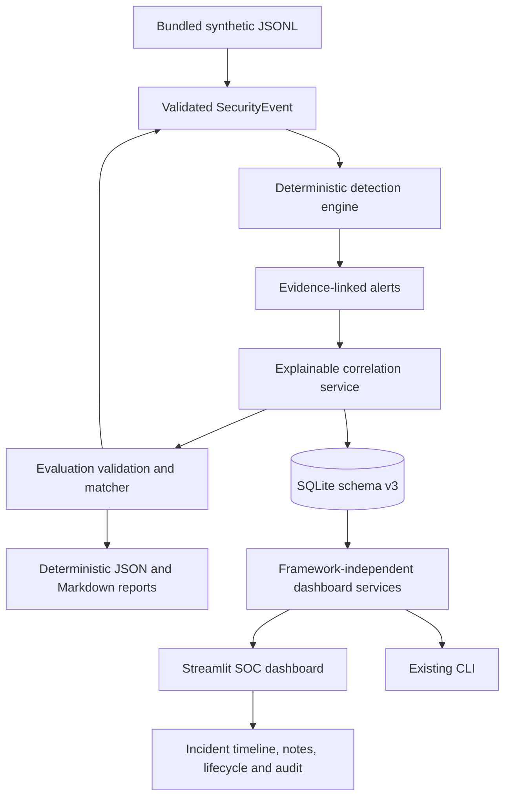

# SOC Sentinel

**A local-first SOC investigation workstation and deterministic detection-engineering lab.**

SOC Sentinel turns normalized synthetic security events into evidence-linked alerts, explainable correlated incidents, and auditable analyst investigations. The dashboard is built with Streamlit and uses the existing Python application services and local SQLite database.

## Principles

- **₹0 by design:** local Python + SQLite; no cloud database, paid API, account, or key.
- **Evidence first:** source event references, detection rationale, correlation explanations, and analyst conclusions remain distinct.
- **Reproducible:** shipped fictional fixtures and declarative rules; stable event and alert IDs make reruns idempotent.
- **Safe by default:** local-only bind, allow-listed synthetic workflows, read-only dashboard queries, version-checked lifecycle updates.
- **Defensive use only:** use synthetic fixtures or logs from systems you own or are authorized to investigate.

## Features

- Dark SOC operations overview with database-backed incident/alert metrics and activity charts.
- Searchable incident explorer with status, severity, time, analyst, host, and username filters.
- Investigation workspace with linked alerts, event evidence, correlation explanations, timeline provenance, notes, and audit history.
- Lifecycle controls for assignment, status, resolution, reopening, and confirmed terminal closure.
- Synthetic lab to run bundled JSONL fixtures through the real detection and correlation services.
- Reproducible synthetic detection evaluation with independent ground truth, evidence-aware matching, per-rule metrics, and JSON/Markdown reports.
- CLI and dashboard share the same application layer; Streamlit is an optional extra and is not imported by normal CLI startup.

## Architecture



The dashboard does not reimplement detection, correlation, persistence, or lifecycle transitions. See [docs/ARCHITECTURE.md](docs/ARCHITECTURE.md) and [docs/DASHBOARD.md](docs/DASHBOARD.md).

## Requirements

- Python 3.11–3.13
- SQLite (included with Python)
- Base runtime: Pydantic 2 and PyYAML
- Optional dashboard: Streamlit
- Development: pytest, Ruff, mypy

## Install and verify

```bash
python -m venv .venv
# Linux/macOS
source .venv/bin/activate
# Windows PowerShell: .venv\Scripts\Activate.ps1
python -m pip install -e ".[dev,dashboard]"
pytest
ruff check .
ruff format --check .
mypy src tests
```

To install only the CLI runtime, use `python -m pip install -e .`; Streamlit is not required for ingestion, detection, correlation, or incident CLI commands.

## Reproduce detection evaluation

Run the committed synthetic benchmark against the existing shipped rules:

```bash
soc-sentinel evaluate --dataset data/evaluation/benchmark.json --rules rules/ --output reports/evaluation/
```

This writes `evaluation.json` and `evaluation.md` under the local report directory. Use `--json` to print the complete report to stdout, or `--fail-on-mismatch` to return exit code 3 if the benchmark identifies false positives or false negatives. Evaluation uses the existing detection engine; ground-truth labels remain outside event records. The benchmark is synthetic and its precision/recall values must not be interpreted as production SOC performance. See [docs/EVALUATION.md](docs/EVALUATION.md).

## Start the dashboard locally

Create a separate synthetic demo database:

```bash
soc-sentinel demo-seed --db data/soc-sentinel-demo.sqlite3
```

Then launch the dashboard bound to loopback:

```bash
# Linux/macOS
SOC_SENTINEL_DB=data/soc-sentinel-demo.sqlite3 streamlit run src/soc_sentinel/dashboard.py --server.address 127.0.0.1
```

Windows PowerShell:

```powershell
$env:SOC_SENTINEL_DB = "data/soc-sentinel-demo.sqlite3"
streamlit run src/soc_sentinel/dashboard.py --server.address 127.0.0.1
```

Open the local URL printed by Streamlit. The repository config also binds the server to `127.0.0.1`. If no database exists, the dashboard shows the exact seed command instead of creating a database silently.

## Synthetic walkthrough and reset safety

The committed fixture `data/samples/soc-demo.jsonl` contains eight fictional events: a five-failure authentication burst followed by a successful login, a suspicious encoded-command indicator, and a benign `-Encoding` lookalike. The example uses documentation-only IP ranges. The simulated command is never executed.

The pipeline should produce three alerts: two related authentication alerts and one separate process alert, grouped into two incidents. These are expected scenario outcomes; the app still calculates all displayed metrics from the persisted database.

Reruns are idempotent:

```bash
soc-sentinel demo-seed --db data/soc-sentinel-demo.sqlite3
```

To explicitly recreate only a demo-named database:

```bash
soc-sentinel demo-seed --db data/soc-sentinel-demo.sqlite3 --reset
```

`--reset` refuses target filenames without `demo` and protects `data/soc-sentinel.sqlite3`. Keep real or important local databases out of the demo reset workflow.

For rule validation and the original CLI:

```bash
soc-sentinel validate-rules --rules rules/
soc-sentinel detect --input data/samples/soc-demo.jsonl --rules rules/
soc-sentinel correlate --input data/samples/soc-demo.jsonl --rules rules/ --db data/soc-sentinel-demo.sqlite3
soc-sentinel list-incidents --db data/soc-sentinel-demo.sqlite3
```

## Screenshots

No screenshots have been captured and verified yet. Capture real screenshots locally after running the dashboard; do not treat this heading as evidence of a live hosted instance.

Suggested portfolio captures:

1. Operations overview with real seeded metrics.
2. Incident explorer with filters and the persisted case queue.
3. Investigation workspace showing evidence IDs and detection rationale.
4. Timeline with security-event and application-audit provenance.
5. Correlation explanation and analyst lifecycle controls.
6. Synthetic lab showing pipeline counts and the benign lookalike.

## Security and deployment posture

The dashboard reads SQLite in read-only mode for queries and routes mutations through the existing transactional services. The checked-in Streamlit config disables usage-statistics reporting. The synthetic lab accepts only known fixture names, shipped rule profiles, and the checked-in correlation policy. No arbitrary shell commands, YAML paths, or HTML supplied by telemetry are executed or rendered.

Do not bind the service to a public interface. An unauthenticated dashboard with incident details and write controls is unsafe to expose publicly. A future ₹0 deployment would still need authentication, authorization, secret/session handling, TLS, and an explicit persistence strategy; free-host filesystems may be ephemeral. No deployment is configured or performed in this phase.

## Quality and project status

CI runs pytest, Ruff lint, Ruff formatting, and mypy on Python 3.11, 3.12, and 3.13. See [GitHub Actions](https://github.com/vansh-kumar-007/soc-sentinel/actions) and [docs/PROJECT_STATUS.md](docs/PROJECT_STATUS.md).

Known limitations include a local single-user workflow, exact-identifier correlation, in-memory event evaluation, and no live telemetry ingestion. Detection evaluation uses a small synthetic benchmark and is not a substitute for production telemetry validation.
